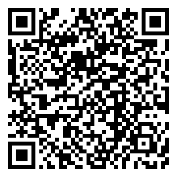

# Macro Deck for 3DS

> **Community project.** This is an unofficial client made by the community. It is not made, maintained or
> supported by the Macro Deck team, so please report problems
> [in this repository](https://github.com/SkyExploreWasTaken/macrodeck-3ds/issues), not to Macro Deck.

A [Macro Deck 3](https://github.com/Macro-Deck-App/Macro-Deck) client for the Nintendo 3DS family. Your deck
lives on the touch screen and the connection status on the top screen. It runs on Old and New 3DS/2DS models.

- **Bottom screen:** the folder's grid of buttons, sliders and displays. Tap to press, hold to long-press, and drag a slider.
- **Top screen:** the computer you're connected to, the profile and folder you're in, the time, battery and Wi-Fi, plus
  any notifications from Macro Deck.
- **Controls:** `L`/`R` switch profiles, `B` goes back a folder, `SELECT` reconnects, `START` opens the menu (settings, updates, **Credits** and
  **Exit app**). The deck is
  touch-only; menus also work with the D-pad or Circle Pad and `A`.

## Install

### Scan with FBI



In FBI, choose **Remote Install > Scan QR Code** and point the camera at this code. It installs the `.cia` from the
[latest stable release](https://github.com/SkyExploreWasTaken/macrodeck-3ds/releases/latest), and the app then
appears on the HOME Menu. After that the app keeps itself current: it checks the
[Nightly build](https://github.com/SkyExploreWasTaken/macrodeck-3ds/releases/tag/nightly) on launch and offers
**Install update** in the `START` menu.

### Manual

Grab the files from [Releases](https://github.com/SkyExploreWasTaken/macrodeck-3ds/releases) (the **Nightly build**
tracks `main`, `v*` releases are stable) or from the **Actions** tab (artifact `MacroDeck3DS`).

| Format | How |
| --- | --- |
| `.cia` | Copy to the SD card and install it with FBI. It then appears on the HOME Menu. |
| `.3dsx` | Copy to `sdmc:/3ds/` and start it from the Homebrew Launcher. |

## Connect

1. In Macro Deck on your computer, turn on **Settings > Network > Show on the local network** (needed for
   auto-discovery).
2. Start the app. In the default **auto-discovery** mode it looks for Macro Deck on your Wi-Fi and connects to the
   computer it finds, or lets you pick one when there are several.
3. The first time, it asks for a **pairing code**. Click the network icon at the top right of Macro Deck and type
   the 6-digit code shown there. The 3DS stays signed in after that.

To use a fixed address instead, open the menu (`START`), choose **Enter address manually** and type the computer's
IP and the **Listening port** from Macro Deck's **Settings > Network** (8193 by default). Manual entry also switches
the launch behaviour to **use saved address**. You can switch it back from the same menu at any time.

Settings and the sign-in are stored in `sdmc:/3ds/MacroDeck3DS/config.json`. **Forget pairing** in the menu signs
the 3DS out.

## What works

- Pairing via code, automatic token refresh, and reconnecting when Wi-Fi or the host drops
- Live widgets through Macro Deck's UI sessions: action buttons with labels, colours and icons (PNG/JPEG/GIF/WebP),
  plus states, clocks, timers and anything else that renders text, images or a level
- Press, long-press, press-start/end and slider changes
- Folder navigation driven by the host, local back (`B`), and profile switching (`L`/`R`)
- Edits you make in Macro Deck show up on the 3DS right away
- Reconnects quietly after the console wakes from sleep
- Screen protection: the backlight turns off after a few idle minutes (set in the menu; the first touch after that
  only wakes the screen), and the whole UI shifts by a pixel every few minutes against image retention
- Checks the Nightly build on launch and updates itself from the menu (`START` > **Install update**). After
  updating, the commit at the bottom right of the top screen changes to the new build's

Not yet supported: animated icons (only the first frame shows), custom fonts, video streams, and widget-specific
gestures beyond press and slide.

## Build

Requires [devkitPro](https://devkitpro.org/wiki/Getting_Started) with `3ds-dev` (libctru, citro2d) and `3ds-curl`
(pulls in mbedTLS and zlib). For the CIA you
also need [makerom](https://github.com/3DSGuy/Project_CTR/releases) and
[bannertool](https://github.com/Epicpkmn11/bannertool/releases) on your `PATH`.

```sh
make        # MacroDeck3DS.3dsx
make cia    # MacroDeck3DS.cia
```

Or with Docker: `docker run --rm -v "$PWD:/src" -w /src devkitpro/devkitarm make`.

GitHub Actions builds both formats on every push, and each push to `main` refreshes the **Nightly build**
pre-release. To publish a stable release, open **Actions > Build > Run workflow**, enter a version such as `v1.0.1`
and run it: it tags the commit, builds it and publishes it as the latest release. Pushing a `v*` tag yourself works
too.

`tools/build_desktop_test.sh` builds the networking and protocol core for Linux/macOS (`build-desktop/desktop_test`),
so it can be tested against a real Macro Deck host without a console.

## Layout

| Path | What |
| --- | --- |
| `source/main.c` | UI thread: drawing both screens, touch and buttons, keyboard prompts |
| `source/client.c` | Network worker: Macro Deck 3 REST + `/ws/ui` protocol, sessions, navigation |
| `source/uitree.c` | Applies UI tree patches and turns a widget tree into a drawable tile |
| `source/http.c`, `ws.c`, `net.c` | Minimal HTTP/1.1 and WebSocket clients on BSD sockets |
| `source/mdns.c` | DNS-SD browser for `_macrodeck._tcp` |
| `source/imgdecode.c` | Icon decoding (stb_image + libwebp) |
| `source/update.c` | Update check and self-install (libcurl, the .cia through the system installer) |
| `lib/` | Vendored cJSON (MIT), stb_image (public domain), libwebp decoder (BSD) |
| `data/cacert.bin` | Mozilla CA bundle (MPL 2.0) for HTTPS to GitHub |
| `meta/` | Icon, banner, banner sound, the CIA's RSF (`tools/make_art.py` regenerates the art) and the install QR code |

## License

Copyright (C) 2026 SkyExploreWasTaken

This program is free software: you can redistribute it and/or modify it under the terms of the GNU General Public
License as published by the Free Software Foundation, version 3 ([LICENSE](LICENSE)). It is distributed in the hope
that it will be useful, but WITHOUT ANY WARRANTY; without even the implied warranty of MERCHANTABILITY or FITNESS FOR
A PARTICULAR PURPOSE.

Bundled and linked libraries keep their own licenses, all compatible with the GPL-3.0. See
[THIRD_PARTY_NOTICES.md](THIRD_PARTY_NOTICES.md).

Not affiliated with or endorsed by the Macro Deck project or Nintendo.

